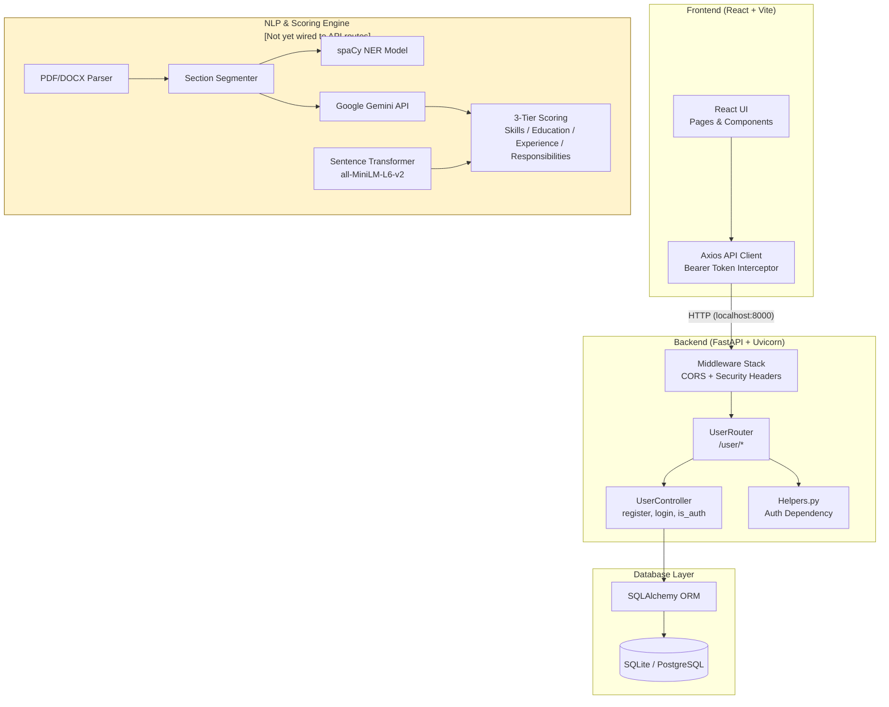
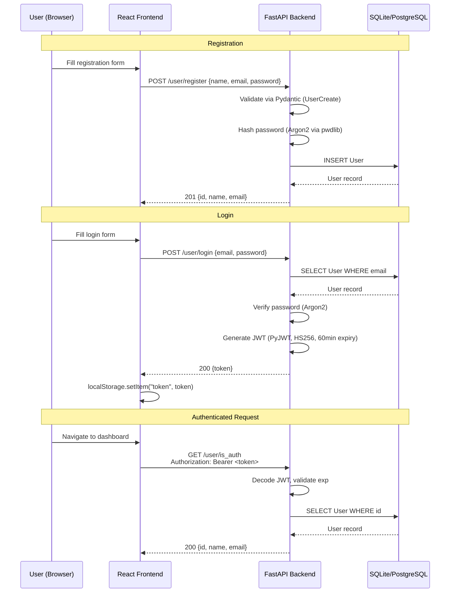
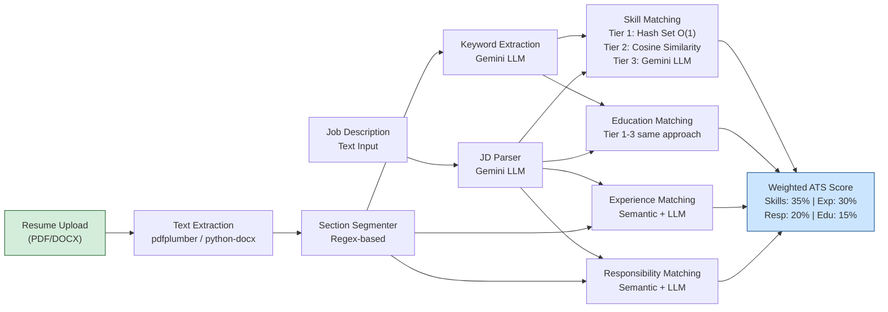
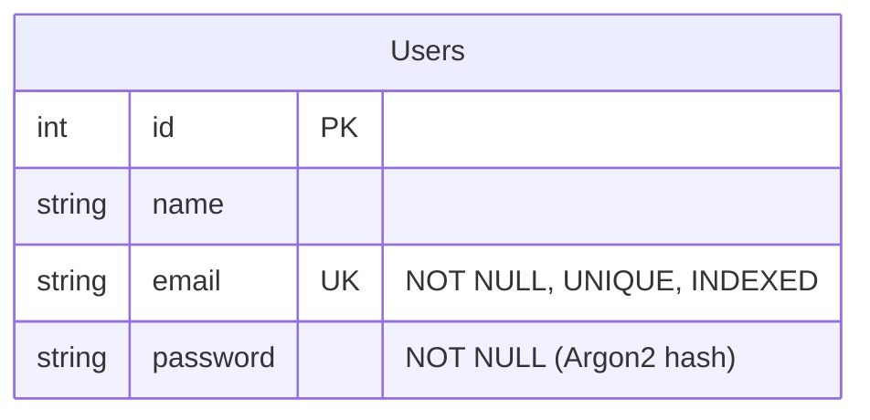

# Architecture — Smart ATS NLP-Based Resume Analyzer

> [!NOTE]
> This document was auto-generated from source code inspection on 2026-10-24.
> All component descriptions are **verified** from the actual codebase unless marked *[inferred]*.

---

## 1. Project Overview

The repository contains a **full-stack Applicant Tracking System (ATS)** with NLP-based resume analysis capabilities:

| Layer | Technology | Evidence |
|-------|-----------|----------|
| Frontend | React 19 + Vite 8 + TailwindCSS 4 | `package.json` |
| Backend | Python FastAPI + Uvicorn | `main.py`, `requirements.txt` |
| Database | SQLAlchemy ORM (SQLite default, PostgreSQL supported) | `db.py`, `Settings.py` |
| Auth | JWT (PyJWT) + Argon2 password hashing (pwdlib) | `Usercontroller.py` |
| NLP | spaCy NER model (custom trained), Sentence Transformers (all-MiniLM-L6-v2) | `train_model.py`, `semantic.py` |
| LLM | Google Gemini API (gemini-3.5-flash-lite) for Tier-3 extraction/validation | `resume_key_sec_ext.py`, `skill_score.py`, etc. |
| Resume Parsing | pdfplumber, python-docx | `resume_parse.py`, `Service_pdf_parse.py` |

---

## 2. Folder Structure

```
Application-TRacking-system-Project/
├── .gitignore                          # Root ignore rules (modified locally)
├── .env.example                        # Root environment template (new, untracked)
├── .vscode/settings.json               # VS Code config
├── README.md                           # Placeholder (1 line)
├── docs/                               # Documentation (new)
│
├── Backend of Smart ATS NLP-Based Resume Analyzer/
│   ├── .env.example                    # Backend env template (new, untracked)
│   ├── .gitignore                      # Backend-specific ignore (empty)
│   ├── main.py                         # FastAPI entry point ★
│   ├── requirements.txt                # Curated deps (modified locally)
│   ├── requirments.txt                 # Original pip freeze (typo in name)
│   ├── .venv/                          # Local Windows venv (untracked by new .gitignore)
│   ├── env/                            # Linux venv (TRACKED in git — 6360 files!)
│   │
│   └── src/
│       ├── __init__.py                 # Package marker (new, untracked)
│       ├── __inti__.py                 # Typo duplicate of __init__.py (original)
│       │
│       ├── Controllers/
│       │   ├── __init__.py
│       │   └── Usercontroller.py       # Auth logic: register, login, JWT ★
│       │
│       ├── Models/
│       │   ├── __init__.py
│       │   └── UserModel.py            # SQLAlchemy User model ★
│       │
│       ├── Routers/
│       │   ├── __init__.py
│       │   └── UserRouter.py           # API route definitions ★
│       │
│       ├── Schemas/
│       │   ├── __init__.py
│       │   └── UserSchema.py           # Pydantic request/response schemas ★
│       │
│       ├── Services/
│       │   ├── Service_pdf_parse.py    # Simple PDF text extractor
│       │   ├── Service_text_cleaning.py # Regex text cleaner
│       │   │
│       │   ├── NLP-pipeline/
│       │   │   ├── preprocessor.py     # Text preprocessor (non-ASCII removal)
│       │   │   ├── train_model.py      # spaCy NER model trainer
│       │   │   ├── training_data.py    # NER training dataset (3400+ lines)
│       │   │   └── ats_ner_model/      # Trained spaCy NER model artifacts
│       │   │       ├── config.cfg, meta.json
│       │   │       ├── ner/ (cfg, model, moves)
│       │   │       ├── tokenizer
│       │   │       └── vocab/ (key2row, lookups.bin, strings.json, vectors)
│       │   │
│       │   └── Parsers/
│       │       ├── resume/
│       │       │   ├── resume_parse.py           # PDF/DOCX raw text extraction
│       │       │   ├── resume_key_sec_ext.py     # Gemini LLM keyword extraction
│       │       │   └── split_resume_text.py      # Regex section segmentation + LLM pipeline
│       │       │
│       │       ├── job_des_ser/
│       │       │   └── job_des_sec_key.py        # Gemini LLM JD parsing
│       │       │
│       │       ├── Sec_score/
│       │       │   ├── semantic.py                # Sentence Transformer model loader
│       │       │   ├── skill_score.py             # 3-tier skill matching engine
│       │       │   ├── education_score.py         # 3-tier education evaluator
│       │       │   ├── experience_score.py        # 3-tier experience evaluator
│       │       │   ├── resp_score.py              # 3-tier responsibilities evaluator
│       │       │   ├── skill_test.py              # Test driver for skill scoring
│       │       │   ├── edu_test.py                # Test driver for education scoring
│       │       │   ├── ex_test.py                 # Test driver for experience scoring
│       │       │   └── res_test.py                # Test driver for responsibilities scoring
│       │       │
│       │       └── Resume-Analysis/
│       │           └── resume_score_evalution.py  # Empty file
│       │
│       └── Utils/
│           ├── __init__.py
│           ├── Helpers.py              # FastAPI auth dependency wrapper ★
│           └── Database/
│               ├── Settings.py         # Pydantic Settings (.env loader) ★
│               └── db.py              # SQLAlchemy engine/session ★
│
└── Smart ATS NLP-Based Resume Analyzer/   # Frontend
    ├── .gitignore
    ├── index.html                      # Vite HTML entry
    ├── package.json                    # npm dependencies
    ├── package-lock.json               # Lockfile (modified locally)
    ├── vite.config.js                  # Vite + React + TailwindCSS
    ├── eslint.config.js                # ESLint config
    ├── README.md                       # Vite boilerplate readme
    ├── dist/                           # Production build (committed to git)
    ├── public/                         # Static assets (favicons, logo)
    │
    └── src/
        ├── main.jsx                    # React DOM entry point
        ├── App.jsx                     # Root component
        ├── index.css                   # TailwindCSS imports
        ├── assets/                     # Images (hero.png, react.svg, vite.svg)
        ├── services/
        │   └── api.js                  # Axios client + Bearer token interceptor ★
        ├── pages/
        │   ├── LandingPage.jsx
        │   ├── LoginPage.jsx
        │   ├── RagisterPage.jsx        # (typo: "Ragister")
        │   ├── DashboardPage.jsx
        │   ├── AnalysisPage.jsx
        │   ├── HistoryPage.jsx
        │   └── LoadingPage.jsx
        └── componets/                  # (typo: "componets" not "components")
            ├── AppRoutes.jsx           # React Router route definitions
            ├── Navbar.jsx
            ├── NavCard.jsx
            ├── Footer.jsx
            ├── LoginPage/
            │   └── FirstCard.jsx
            ├── RegisterPage/
            │   └── FormCard.jsx
            ├── DashboardPage/
            │   ├── TopCard.jsx, MiddelCard.jsx, BottomCard.jsx
            │   ├── Button.jsx, ButtonDashboardHistory.jsx
            │   ├── DashboardHistoryCard.jsx
            │   └── Logo.jsx
            └── LandingPage/
                ├── Landing.jsx, SecondPage.jsx, ThirdPage.jsx
                ├── Card.jsx, CardThird.jsx
                ├── Button.jsx, Companes.jsx
                └── v.mp4               # Hero video
```

---

## 3. Architecture Diagrams

### 3.1 High-Level Component Diagram



### 3.2 Authentication Flow



### 3.3 Resume Analysis Pipeline (NLP Scoring)



### 3.4 Database Entity-Relationship Diagram



> [!NOTE]
> Currently only a single `Users` table exists. There are no tables for:
> resumes, job descriptions, analysis results, or history.
> The frontend has pages for Dashboard, Analysis, and History, but these
> are not yet backed by API endpoints or database models.

---

## 4. API Inventory

| Method | Endpoint | Auth Required | Request Body | Response | Status |
|--------|----------|---------------|-------------|----------|--------|
| `GET` | `/` | No | — | `{status, service, version}` | Health check |
| `GET` | `/health` | No | — | `{status, service, version}` | Health check |
| `POST` | `/user/register` | No | `{name, email, password}` | `{id, name, email}` | 201 |
| `POST` | `/user/login` | No | `{email, password}` | `{token}` | 200 |
| `GET` | `/user/is_auth` | Yes (Bearer) | — | `{id, name, email}` | 200 |

> [!IMPORTANT]
> There are **no API endpoints** for resume upload, resume analysis, job description
> input, score retrieval, or history. The NLP pipeline code exists as standalone
> modules with test drivers but is **not wired** into the FastAPI application.

---

## 5. Technology Stack (Verified)

### Backend
| Category | Technology | Version | Source |
|----------|-----------|---------|--------|
| Framework | FastAPI | ≥0.115.0 | `requirements.txt` |
| ASGI Server | Uvicorn | ≥0.32.0 | `requirements.txt` |
| ORM | SQLAlchemy | ≥2.0.30 | `requirements.txt` |
| Database Driver | psycopg2-binary (PostgreSQL) | ≥2.9.9 | `requirements.txt` |
| Settings | pydantic-settings | ≥2.6.0 | `requirements.txt` |
| Auth - JWT | PyJWT | ≥2.9.0 | `requirements.txt` |
| Auth - Hashing | pwdlib[argon2] + argon2-cffi | ≥0.2.0 | `requirements.txt` |
| PDF Parsing | pdfminer.six, pdfplumber, pypdfium2 | Various | `requirements.txt` |
| DOCX Parsing | python-docx | ≥1.1.2 | `requirements.txt` |
| NLP - NER | spaCy (blank "en" model, custom trained) | Not in requirements.txt | `train_model.py` |
| NLP - Embeddings | sentence-transformers (all-MiniLM-L6-v2) | Not in requirements.txt | `semantic.py` |
| NLP - Similarity | scikit-learn (cosine_similarity) | Not in requirements.txt | `skill_score.py` |
| LLM | google-genai (Gemini API) | Not in requirements.txt | `resume_key_sec_ext.py` |
| Testing | pytest, httpx | ≥8.3.0, ≥0.27.0 | `requirements.txt` |

### Frontend
| Category | Technology | Version | Source |
|----------|-----------|---------|--------|
| UI Library | React | 19.2.5 | `package.json` |
| Build Tool | Vite | 8.0.10 | `package.json` |
| CSS | TailwindCSS 4 | 4.3.0 | `package.json` |
| HTTP Client | Axios | 1.18.1 | `package.json` |
| Routing | react-router-dom | 7.16.0 | `package.json` |
| Icons | lucide-react | 1.3.0 | `package.json` |

---

## 6. Entry Points & Commands

| Component | Entry Point | Command |
|-----------|-------------|---------|
| Backend | `main.py` | `uvicorn main:app --reload --host 0.0.0.0 --port 8000` |
| Frontend | `src/main.jsx` via `index.html` | `npm run dev` (Vite dev server on port 5173) |
| Frontend Build | — | `npm run build` |
| NER Training | `src/Services/NLP-pipeline/train_model.py` | `python train_model.py` (standalone) |
| Score Tests | `src/Services/Parsers/Sec_score/*_test.py` | `python skill_test.py` etc. (standalone) |

---

## 7. Files Identified as Obsolete, Duplicated, or Generated

| File | Issue | Recommendation |
|------|-------|---------------|
| `requirments.txt` | Typo name; contains raw `pip freeze` output with pinned versions | Keep `requirements.txt` only |
| `src/__inti__.py` | Typo of `__init__.py` | Delete after verifying no imports reference it |
| `env/` (6360 files tracked) | Entire Linux virtualenv committed to Git | Remove from tracking |
| `__pycache__/` (2737 files tracked) | Python bytecode cache committed to Git | Remove from tracking |
| `dist/` (frontend build) | Production build committed to Git | Remove from tracking |
| `.venv/` | Windows virtualenv (on disk, not tracked) | Already in .gitignore |
| `split_resume_text.py` lines 83-110 | Dead code running outside `if __name__` guard — executes on import | Fix or remove |
